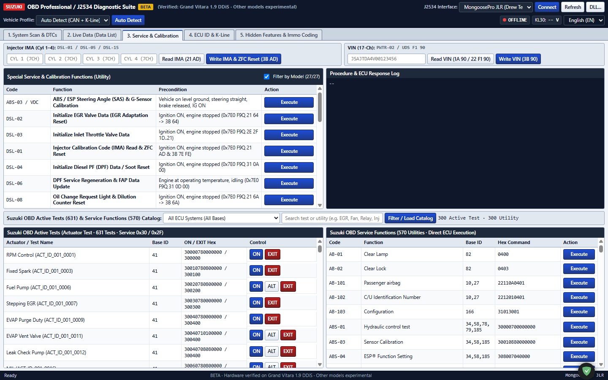
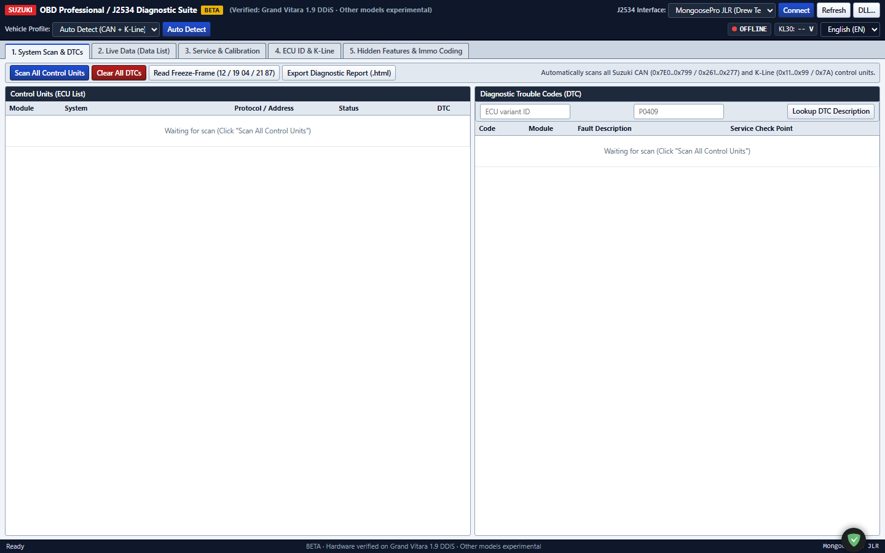
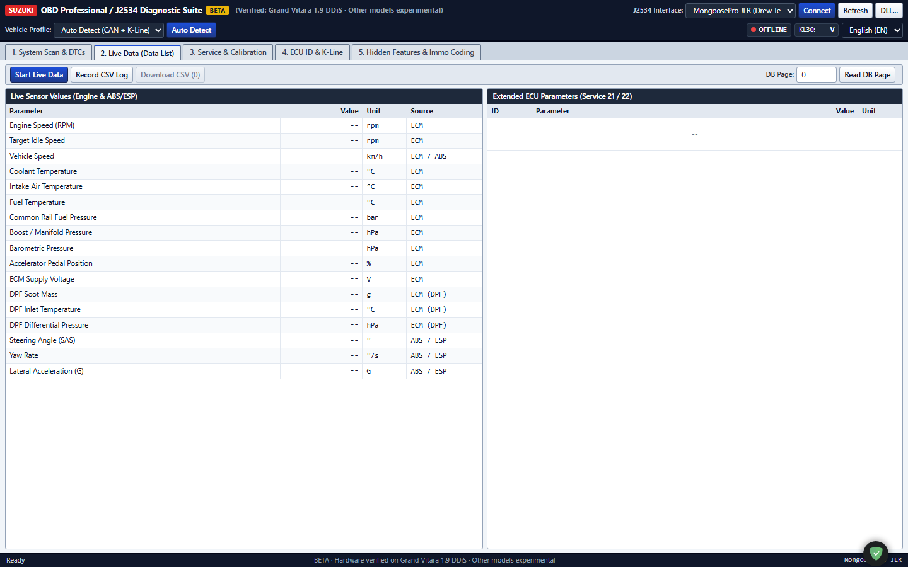
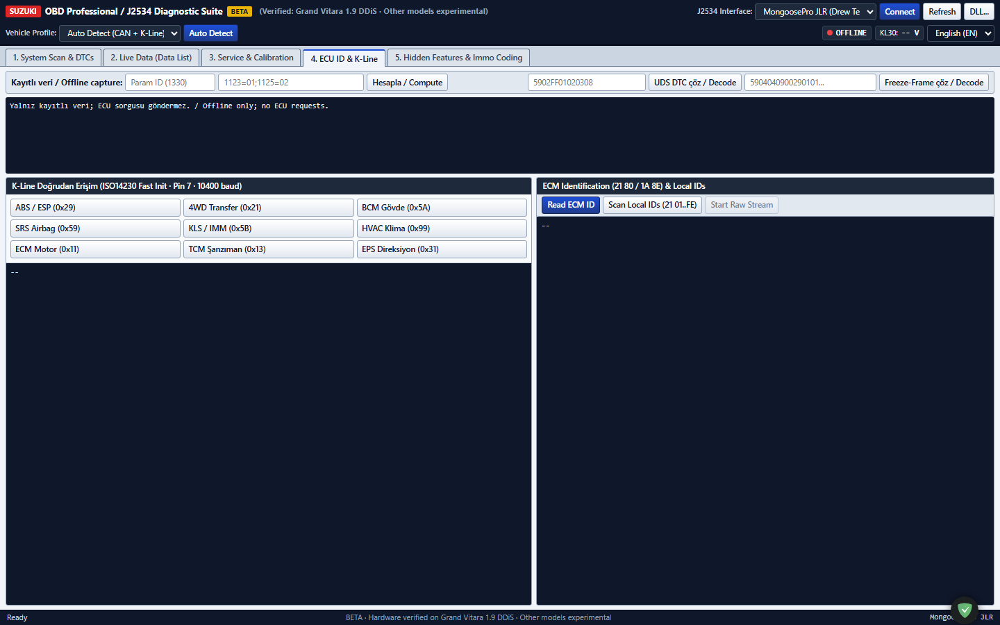
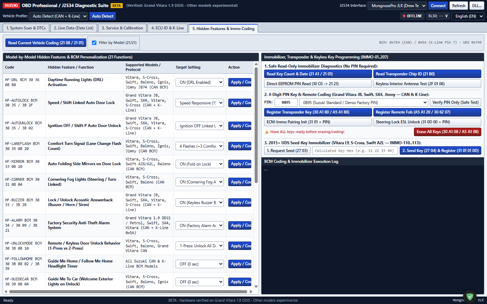

# Suzuki OBD Professional (J2534 Diagnostic Suite) — BETA

### Professional Multi-ECU Diagnostic, Calibration, Coding & Key Programming Software for Suzuki Vehicles
**Lead Engineer:** [Ayem Kaan Yildirim — Automotive Systems & Energy Storage Engineer](https://kaanyildirim.com/)  
**Zero External Dependencies · Native C++ Server Engine · Standalone SAE J2534 Stack**

[-lightgrey.svg)](https://github.com)
[%20%7C%20ISO%2014230%20(K--Line)%20%7C%20ISO%2014229%20(UDS)-orange.svg)](https://github.com)

[%20%7C%20T%C3%BCrk%C3%A7e-blueviolet.svg)](https://github.com)

---

> [!WARNING]
> **BETA RELEASE — HARDWARE VERIFICATION NOTICE**
> This software is currently in active **BETA** stage. Not 100% of Suzuki models or write routines have been physically field-tested yet.
> - **Physically Hardware-Verified Operations (Suzuki Grand Vitara 1.9 DDiS JB419D / F9Q):** CAN (`0x7E0`) session/DTC/live telemetry, K-Line Pin 7 BCM (`0x5A`) `21 08` EEPROM read, and K-Line ABS/ESP (`0x29`) `21 00` telemetry & DTC read.
> - **Unverified / SDT-II Mapped Routines:** Calibration resets, Injector IMA writing, VIN registration, BCM hidden-feature writes, Immobilizer key programming (`0x5D` / `0x5B` / UDS), and other Suzuki chassis/models are mapped from SDT-II definitions with session/variant safety guards and are **awaiting physical vehicle validation**. Use write/key/BCM routines cautiously on a real vehicle.

---

## 📸 Interface Walkthrough & Screenshots

All 5 core functional modules have been captured directly from the live application running in high-resolution:

### Tab 1: System Scan & Multi-ECU DTC Inspection
*Full vehicle diagnostic scan across Powertrain, ABS/ESP, BCM, Airbag, EPS, IPC, Climate, and Keyless with 1-click HTML report export.*

---

### Tab 2: Live Sensor Telemetry & Road-Test CSV Logger
*Real-time sensor monitoring (RPM, Rail Pressure, Boost, DPF Soot/Differential Pressure, SAS Angle, Yaw Rate) + timestamped CSV recording.*

---

### Tab 3: Service, Calibrations & Actuator Tests
*27 vehicle-filtered quick calibration cards, Injector IMA (Cyl 1–4) coding, 17-digit VIN registration, 631 active tests & 570 utility routines.*

---

### Tab 4: Direct K-Line Terminal & ECU Identification
*Direct ISO 14230 Fast Init terminal for Suzuki Pin 7 K-Line controllers (0x29 ABS, 0x21 4WD, 0x5A BCM, 0x59 Airbag, 0x5B IMM, 0x99 AC, 0x11 ECM).*

---

### Tab 5: Hidden Features (BCM Coding) & Immobilizer Key Programming
*21 model-specific personalization features + complete Immobilizer transponder chip registration, remote coding, and ESL unlock.*

---

## 🌟 Overview & Architecture

**Suzuki OBD Professional** is a standalone, high-performance diagnostic suite specifically engineered for Suzuki vehicles using any compliant **SAE J2534 PassThru** interface (MongoosePro JLR/Toyota, Scanmatik 2 Pro, Tactrix OpenPort 2.0, VCX SE, Chipsoft, etc.).

- **Standalone Native Core:** Compiled into a single 32-bit Windows executable (`suzuki_diag_server.exe`) with zero external runtime dependencies.
- **Embedded Web Dashboard:** Responsive single-screen interface (`index.html`) with English set as permanent default and instant one-click Turkish localization.
- **Multi-Protocol Engine:** Synchronous support for **CAN (500 kbps)**, **K-Line Pin 7 (ISO 14230-4 Fast Init @ 10,400 baud)**, and **UDS (ISO 14229)** with automatic bus arbitration and fallback.

---

## 🚀 Key Modules & Capabilities

### 1. System Scan & Full Vehicle DTC Inspection (Tab 1)
- **Deep Multi-ECU Topology:** Scans Powertrain (ECM/TCM), ABS/ESP/VDC, 4WD/AllGrip, BCM (Body Control), SRS Airbag, EPS (Electric Power Steering), IPC (Combination Meter), HVAC Climate Control, TPMS, and Keyless Entry/Immobilizer.
- **Intelligent ECU Recognition:** Matches against `4,058` ECU identity rules and `1,636` model variants to configure service scripts specifically for your chassis.
- **Extensive DTC Library:** `18,225` factory DTC descriptions with diagnostic check points.
- **Freeze-Frame Analysis:** Automatic frame decoding across Service `12`, Service `19 04`, and Service `21 87`.
- **1-Click HTML Report Export:** Generates clean, printable `.html` diagnostic health reports.

### 2. Live Data Telemetry & Road-Test CSV Logger (Tab 2)
- High-rate streaming of essential engine and chassis parameters (RPM, Common Rail Pressure, Boost Pressure, DPF Soot Load, Differential Pressure, EGT Temperatures, Steering Angle Sensor [SAS], Yaw Rate, Lateral Acceleration).
- Extended access to `6,337` parameters (Services `21` / `22`) and `165` computed formulas.
- **Road-Test CSV Recorder:** Timestamped `.csv` logging with one-click export for spreadsheet tuning and diagnosis.

### 3. OEM Service, Calibrations & Actuator Tests (Tab 3)
- **27 One-Click Quick Service & Calibration Cards:**
  - **Grand Vitara 1.9 DDiS (`F9Q`):** EGR adaptation reset, Inlet throttle flap calibration, Injector IMA read & ZFC reset, DPF soot initialization, DPF service regeneration, Oil dilution counter reset, Common rail high-pressure leak check, ECM memory transfer, Starter motor check.
  - **CAN Diesel (`D13A` / `D16AA` / `D20AA`):** DPF regeneration, Oil service reset, EGR learning value reset, Diff-pressure / MAF / Rail component replacement resets.
  - **Petrol Powertrain:** Electronic throttle learning, Idle Air Control (`IAC`) reset, Short/Long term fuel trim reset, Brake stroke learning, GPF adaptation.
  - **Chassis & Body Systems:** ABS/ESP Steering Angle (`SAS`) & G-Sensor calibration, ABS hydraulic air bleeding, TCM/CVT/AMT clutch learning reset, EPS zero-point calibration, Airbag crash history clear, TPMS sensor registration, IPC service reminder reset, Auto Headlight Leveling (`ALC`) sensor init.
  - **New Calibrations:** `EPB-01` Electronic Parking Brake pad replacement mode, `HVAC-01` Climate air mix flap & compressor init, `HVBMU-01` SHVS Mild-Hybrid / Strong Hybrid BMU reset, and `ADAS-01` Camera/Radar/BSM calibration.
- **Injector IMA Coding Box:** Cylinder 1–4 individual 7-character IMA code read (`21 AD` / `21 54`) and write (`3B AD FF`) with automated Zero Fuel Calibration (`3B 7E FE`) reset.
- **17-Digit VIN Read & Write Box:** ECM chassis number read (`1A 90`, `22 F1 90`, `21 90`, `09 02`) and registration/write (`3B 90` / `2E F1 90`) with security access unlock.
- **Database Catalog:** Searchable catalog of **631 Active Tests** and **570 Utility Procedures**.

### 4. ECU Identification & Direct K-Line Access (Tab 4)
- Direct ISO 14230 Fast Init terminal for Suzuki Pin 7 K-Line controllers (`0x29` ABS, `0x21` 4WD, `0x5A` BCM, `0x59` SRS, `0x5B` IMM, `0x99` AC, `0x11` ECM, `0x13` TCM, `0x31` EPS).
- Local ID scanner (`21 01` .. `21 FE`) and offline hex packet decoder.

### 5. Hidden Features, BCM Coding & Immobilizer Key Programming (Tab 5)
- **Model-Specific BCM Coding & Safety Locks:**
  - **Dynamic Compatibility Filter:** Features not present in the vehicle's electrical architecture (e.g., auto folding mirrors, cornering fogs, comfort lane flash on Grand Vitara JB) are automatically disabled, locked (`disabled`), and prevented from executing by dual-layer safety locks.
  - **Live EEPROM State Readout (`21 08` / `21 01`):** Reads active vehicle coding and instantly highlights feature states with high-visibility badges (`● ON / ACTIVE` vs `○ OFF / DISABLED`), automatically pre-selecting current parameters in dropdowns.
  - **21 Cataloged Functions:** Speed-dependent auto locking (15 km/h), auto unlock on IG-OFF / Shift-P, 1-press vs 2-stage unlock, interior dimmer fade timer, retained power window timer, factory security alarm, lock answerback (hazard flash vs interior dome light), acoustic buzzer, follow-me-home headlight delay, and ESP Dyno / Off-road full deactivation mode.
- **Immobilizer & Key Programming (`IMMO-01..207`):**
  - **Safe Read-Only Operations:** Key count & date (`21 A1`), Transponder chip ID (`21 B0`), Direct EEPROM PIN read (`10 C0 -> 21 21`), Keyless interior antenna check.
  - **4-Digit PIN Operations:** Presets (`0895`, `9502`, `5634`, `0325`), Safe PIN test, Transponder key registration (`30 A1 80` / `A5 A1 80`), Remote fob programming (`A5 A1 20` / `30 62 07`), ECM-Immobilizer sync, Electronic Steering Lock (`ESL`) unlock, and Double-confirmed erase all keys.
  - **2015+ UDS Seed-Key Routine:** Dynamic seed request (`27 03`) and calculated key unlock (`27 04 -> 31 01 01 0D`).

---

## ✅ Field-Tested & Hardware-Verified Features (Live Vehicle Read / Scan)

The following read, scan, and telemetry functions have been **physically field-tested on a live vehicle** (Suzuki Grand Vitara 1.9 DDiS JB419D / Bosch EDC16C39 / F9Q) connected via MongoosePro JLR PassThru. Write routines (BCM write, key programming, IMA write, DPF/EGR resets) are **not yet field-verified**:

| Module / System | Physical Layer | Protocol / Address | Validated Operations | Current Status |
| :--- | :--- | :--- | :--- | :--- |
| **Engine ECM (Bosch EDC16C39)** | High-Speed CAN | `ISO 15765-4` (ID `0x7E0` / `0x7E8`) | • Diagnostic Session Start (`10 C0` -> `50 C0`) • Full DTC Inspection & Clear (`18 00 FF 00` / `14 FF 00`) • Renault F9Q Multi-PID Live Stream (`21 A4..C0`: 800 RPM, 298 bar Rail Pressure, 84°C Coolant, Boost, DPF EGT & Differential Pressure) • Persistent CAN/K-Line channel scopes implemented for multi-step procedures | **READ / SCAN VERIFIED** *(Writes unverified on car)* |
| **Body Control Module (BCM)** | K-Line Pin 7 | Suzuki 4-Byte `ISO 14230` (Target `0x5A`) | • 4-Byte Header Session (`0x80 0x5A 0xF1 0x02 0x10 0xC0`) • 37-Byte Factory EEPROM Read (`21 08`) • Real-time decoding of Alarm, Answer-Back, Auto-lock 15 km/h, Unlock modes, Dome Dimmer, Buzzer | **READ VERIFIED** *(Coding writes unverified)* |
| **Brake & Stability (ABS/ESP)** | K-Line Pin 7 | `ISO 14230` (Target `0x29`) | • 34-Byte Telemetry Read (`21 00`: Steering Angle `7.0°`, Lateral G, Yaw Rate, Battery) • ABS DTC Fault Capture (`C1021`) • SAS calibration precondition diagnostics (`7F A5 23` analyzer) | **READ VERIFIED** *(SAS reset blocked by `C1021` on test car)* |
| **Immobilizer & Keyless (KLS)** | K-Line Pin 7 & CAN | `ISO 14230` (`0x5D`) / CAN (`0x275`) | • Model architecture routing (`SuzukiImmoSystem`) & multi-stage PIN-then-action session logic • Fail-closed lock when `auto` vehicle identity is unverified | **CODE IMPLEMENTED** *(Pending live `0x5D` vehicle test)* |
| **Vehicle Architecture Filter** | Frontend & C++ | Multi-Tab Safety Core | • Fails closed on unidentified `auto` / unknown profiles for writes & BCM coding • Disables unsupported features per model profile | **ACTIVE SAFETY GUARD** |
| **Telemetry CSV Recorder** | Native Web App | Client-side File Stream | • Real-time road-test telemetry logging to timestamped CSV files | **VERIFIED** |

---

## 📊 Official Suzuki SDT-II Database Comparison & Future Roadmap

Our engineering stack directly integrates and references the official Suzuki SDT-II factory database (`ngds2.decrypted.db`):

| Database Asset | Official Suzuki SDT-II Catalog | Suzuki OBD Professional (Current Release) | Coverage & Status |
| :--- | :--- | :--- | :--- |
| **Diagnostic Trouble Codes (DTC)** | **18,329** Factory DTCs | **18,329** Comprehensive DTC Definitions | **100% Matched** across Powertrain, Chassis, Body, Airbag, Network |
| **ECU Variants & Base IDs** | **3,806** Variants / **238** Base IDs | **3,806** ECU Variants / **238** Base IDs | **100% Matched** (`suzuki_db_catalog.h` catalog engine) |
| **ECU Identification Signatures** | **4,421** Identification Signatures | **4,421** Ident Rules | **100% Matched** for 1-click Auto-Detection |
| **Actuator & Active Tests** | **1,426** Official Active Tests | **631** Core High-Frequency Actuator Tests | Core powertrain, fan, pump, ABS bleeding & flap routines mapped; remaining 795 specialized tests stored in catalog |
| **OEM Service Utilities** | **988** OEM Service Utilities | **570** Compiled Procedures + **27** High-Level Dedicated Quick Cards | Injector IMA, DPF Regen/Reset, EGR Adapt, SAS Calib, VIN, and Key Coding routines adapted from SDT-II with persistent session & step validation guards (live vehicle write tests pending) |
| **Live Telemetry Parameters** | **25,016** PIDs / 221,454 links | Core Powertrain, Turbo, Fuel, DPF, SAS, Yaw, Battery, Trans Telemetry | Fast multi-frame parser mapped for essential live road diagnostics |
| **CAN Network Bus Check** | 199 Vehicle Topology Profiles | Multi-ECU Ping Scan (Tab 1) | Deep CAN/LIN Gateway tree analysis roadmap |
| **Security Gateway (SGW)** | 2018+ Suzuki SGW Unlock | UDS Seed-Key (IMMO-110..113) | Standard UDS Security Access implemented; SGW cloud token bypass planned for future release |
| **Multilingual Support** | 19 Languages (453k strings) | Bilingual: **English (Default)** & **Türkçe** | Instant one-click toggle with zero UI disruption |

---

## 🛠️ Hardware Requirements & Tested Interfaces

Compatible with any SAE J2534-1 / J2534-2 compliant PassThru adapter running on 32-bit DLLs:
- **Drew Technologies:** MongoosePro JLR, MongoosePro Toyota, CarDAQ-Plus
- **Scanmatik:** SM2 / SM2 Pro (USB & Bluetooth)
- **Tactrix:** OpenPort 2.0
- **Allscanner:** VCX SE, VCX Nano
- **Chipsoft:** J2534 Pro / Lite
- **Generic:** Any PassThru device registered under Windows `Software\PassThruSupport.04.04`

---

## ⚡ Quick Start & Download

### 1. Pre-Compiled Standalone Release (Ready to Use)
Download the standalone portable release archive directly from this repository:
- **Download:** [`docs/Suzuki_OBD_Professional_v2.28.01_Beta.zip`](docs/Suzuki_OBD_Professional_v2.28.01_Beta.zip)

**Setup Steps:**
1. Extract the downloaded `.zip` file into any local directory.
2. Connect your SAE J2534 PassThru interface to your computer's USB port and the car's OBD-II port.
3. Turn the vehicle's **Ignition ON** (engine stopped for calibrations/coding; engine idling for live sensor streaming).
4. Double-click `Suzuki_Diyagnostik_Baslat.bat` (or run `suzuki_diag_server.exe`).
5. The diagnostic dashboard will automatically open in your default browser at `http://127.0.0.1:8890`.
6. Select your detected J2534 interface from the dropdown list and click **Connect**.

### 2. Standalone Architecture & Distribution
- **Zero External Runtimes:** No Python, Node.js, .NET runtime, or web server installation required.
- **Embedded Web Server:** High-speed native C++ HTTP & WebSocket server handling all ISO PassThru frame arbitration internally.
- **Client Interface:** Single-page responsive dashboard (`index.html`) running locally with zero internet dependency.
- **Licensing:** Distributed under the terms of [`LICENSE.md`](LICENSE.md) for personal vehicle diagnostic evaluation.

---

## 👨‍💻 Engineering & Lead Developer

Developed and engineered by **[Ayem Kaan Yildirim](https://kaanyildirim.com/)**  
*Automotive Systems & Energy Storage Engineer*  
- **Official Website & Portfolio:** [https://kaanyildirim.com/](https://kaanyildirim.com/)
- **Specialization:** Automotive Embedded Diagnostics, CAN/K-Line Protocol Engineering, Battery Management Systems (BMS), Electric Vehicle Energy Storage Solutions.

---

## ⚖️ Disclaimer
This project is an independent diagnostic development for standard SAE J2534 PassThru hardware. It is not affiliated with, sponsored by, or endorsed by Suzuki Motor Corporation. All trademarks and brand names belong to their respective owners. Provided strictly "AS IS" under BETA testing terms.
